# 简辑（UAE2 Studio）

一个 Rotato 风格的 **3D 视频编辑器**（Web）。当前阶段：编辑器骨架 + 完整经典布局 + 可播的时间线。

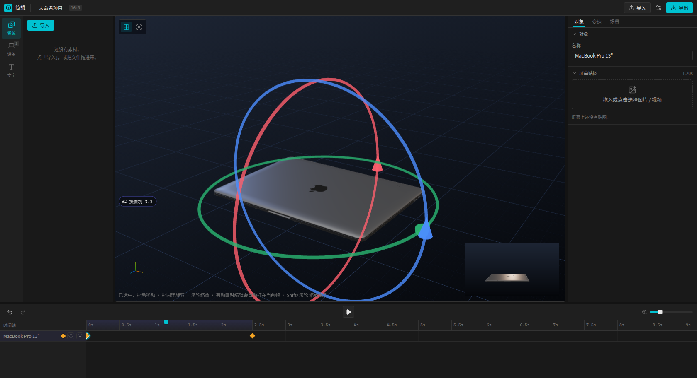

```
┌──────────────────────────────────────────────────────────────────────┐
│ 顶栏  简辑 · 项目名(点击改名)          导入 · 设置(画幅) · 导出        │
├──┬─────────┬────────────────────────────────┬────────────────────────┤
│导│         │                                │                        │
│航│  素材区  │            编辑区               │        参数区          │
│栏│ 资源/设备│   three.js 视口 + 网格/复位视角 │   对象 / 变速 / 场景   │
│  │  /文字   │     + 右下角拍摄小窗            │                        │
│纵│         │                                │                        │
│向│         │                                │                        │
├──┴─────────┴────────────────────────────────┴────────────────────────┤
│ 时间线  撤回/重做 · ▶(弹窗播放) · 缩放滑块 · 每对象一行 · 关键帧 · 无限标尺│
└──────────────────────────────────────────────────────────────────────┘
```

## 快速开始

```bash
npm install
npm run dev      # http://127.0.0.1:5273/
npm run build    # tsc --noEmit && vite build
```

打开时是一个**只有第一帧**的空白工程：设备待在原位，进度轨上只有 0.00s 处一个关键帧，
所以**视频时长是 0** —— 把播放头挪到后面、动一下对象或机位、按 `D` 打第二帧，
片子才开始有长度。片长永远等于"所有关键帧里最靠后的那一个"。

而且**打开时就停在这一帧上**：参数区直接是「对象 / 变速」两个页签（而不是相机、场景那一排），
因为此刻唯一有意义的事情就是这一帧长什么样、以及它到下一帧之间怎么走。
只是首帧之前没有内容，所以**变速页会写明「对于首帧，此设置无效」**。

参数区**永远在看某一帧**，一共三页，没有"没选帧"的状态：

| 页签 | 管什么 |
| :-- | :-- |
| **对象** | 这一帧的**对象名**、**隐藏**与**切换方式**（瞬间 / 渐隐渐显），以及（仅 3D 模型）这一帧的屏幕贴图 |
| **变速** | 这一帧与上一帧之间的播放速度 |
| **场景** | 这一帧的**背景**（纯色 / 渐变）与环境照明（环境强度、曝光）|

- **打开就是首帧**：初始状态直接落在第一个关键帧上（`0.00s`），参数区就在它的编辑区里。
- **隐藏属于帧**：对象页的「隐藏」开关写的是**播放头那一帧**（跟写坐标一样会打帧），
  所以它不是一个静态的显隐开关，而是消失 / 出现的关键帧。时间线上被隐藏的那一帧画成**空心菱形**，
  一眼就能认出这对关键帧。
- **切换方式也属于「到达的那一帧」**（和变速同理）：在"它没了"的那一帧选渐隐，那次消失就铺满
  上一帧到这一帧的整段。「瞬切」是默认值，所以只有想渐隐时才需要动它。

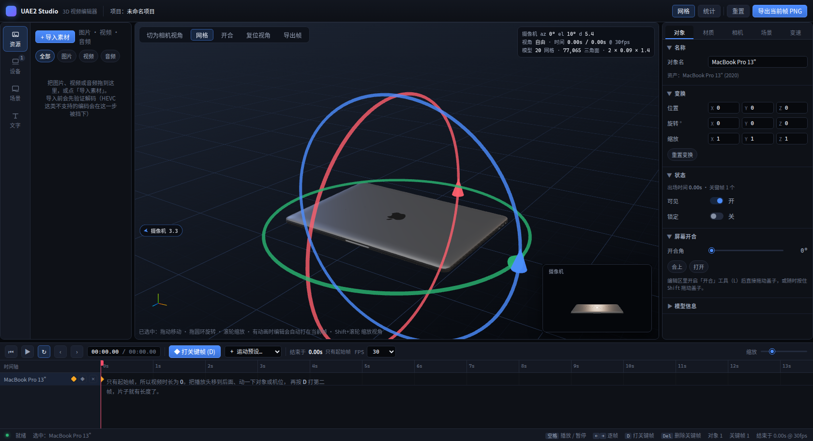
- **没有退出键**：以前那个退出关键帧上下文的 `✕` 已经去掉了 —— 面板不离开帧，点时间线上
  任意关键帧就切过去。
- **单击视频片段**时只剩「变速」一页：片段没有自己的贴图，贴图属于关键帧。
- **相机页已去掉**：机位目前由「摄像机视角 + 滚轮推拉」调整；方位与仰角暂时没有 UI 入口
  （要接回来只需在摄像机视角下把拖动映射到 `updateCamera`）。
- **对象页多了一个名称**：任何对象都能在这里改名（文字卡的标题、时间线的行名都会跟着变）。

**摄像机不在进度轨上。** 它不是被摆放的物体，而是拍摄它的那只眼睛。

**怎么进 / 怎么出**（两条路，都不止单向）：

- 场景里那台**摄像机图标本身可以点** —— 点它就进入摄像机视角（图标在画面里时走这条）。
- 图标不在画面里时，视口边缘会浮出一颗**「◀ 摄像机 3.3」胶囊**指着它的方向，点它同样进入。
- 进入之后这颗胶囊**不会消失**，而是停在左上角变成**「↩ 退出摄像机视角」** —— 点它回到自由视角。
  （早先的版本在进入后把胶囊卸载了，于是那是一次**单向**操作，已经修掉。）

**摄像机视角是一次"瞄一眼"，不是一种模式。** 在它里面：

| 手势 | 作用 |
| :-- | :-- |
| **拖动空白处** | **退出摄像机视角**，并把这一次拖动接着用来旋转自由视角 —— 伸手去动视角，就是在说"我要看场景了" |
| 滚轮 | 推拉镜头（`updateCamera({ distance })`，这在摄像机视角里仍然有意义）|
| 拖动对象 / 圆环 / 盖子 | 照旧操作那个对象，**不会**退出摄像机视角 —— 动的是对象，不是视角 |

所以从摄像机视角出来有两条路：**拖一下视角**（连续手势，不会丢动作），或点左上角那颗
「↩ 退出摄像机视角」。

实现上有两个坑：`CameraRig` 在摄像机视角下会**每帧用 store 里的机位覆写相机**，所以指针不能
直接交给 OrbitControls；而模式又是在**拖动过程中**翻转的，因此监听器**不能按模式挂载**
（按模式挂载会在手势中途把自己拆掉，只剩第一步生效）。做法是监听器常驻、按下时记住"我是在
摄像机视角里按的"，第一次移动时才决定这一拖归谁 —— 对象、圆环、盖子都会在 pointerdown 里
`beginGesture()`，谁先认领谁赢。旋转速率按量到的 OrbitControls 速率（约 0.28°/px）折算，
切换那一刻手上感觉不到接缝。

没有选中任何对象时按 `D` 打的是**摄像机关键帧**；摄像机关键帧仍然参与"片子到哪儿结束"的计算。

## 预览播放时不标记

点播放之后**对象进入只读**：`D`、拖动、开合、换贴图全部不生效（store 里这些动作在
`timeline.playing` 时直接返回），视口下方写明「预览播放中：不能标记对象 —— 暂停后才能拖动 /
打帧 / 换贴图」。暂停后一切恢复 —— 预览就是预览，不会一边播一边把画面改掉。
（播放弹窗打开时同理：那一整段时间线都在跑。）

## 核心设计

**1. 每个对象一条独立时间轴，求值是纯函数。**
没有全局的轨道和片段：每个对象（摄像机也算一个对象）各自持有一串**关键帧**，
关键帧记的是绝对时刻和绝对姿态。`evaluateFrame(snapshot, time)` 从当前时刻解析式算出
每个对象的姿态，帧与帧之间不累积任何状态 —— 往回拖播放头、跳帧、循环，结果永远一致。
没打过关键帧的对象就用自己的 `transform`，所以刚拖进来的设备是静止的，直到你按 D。

```ts
// 一段内容的重定时：先按变速曲线积分，再插值
const u = (time - from.time) / (to.time - from.time)      // 播放位置
const p = ∫₀ᵘ v(x)dx / ∫₀¹ v(x)dx                          // 内容进度（单调，必定抵达关键帧）
pose = lerp(from.pose, to.pose, p)
```

**2. 播放不触发 React 重渲染。**
时钟写在 `usePlaybackClock` 的 rAF 里，3D 侧（`DeviceModel` / `CameraRig`）在
`useFrame` 中用 `getState()` 直接读时间并**命令式**写矩阵；只有播放头和码表两个
小组件订阅 `currentTime`。60fps 播放时整棵树是静止的。

**3. 相机有主。**
没有相机片段时，`OrbitControls` 说了算，手势结束后把球坐标写回 store（参数区数值实时同步）；
当前时刻存在相机片段时，机架接管、禁用控制器，按片段求值写相机 —— 拖动播放头就是回放运镜。

**4. 模型自动归一化。**
`prepareModel()` 克隆 glTF、量包围盒、居中、把最长边缩放到 2 个场景单位、底面落到 y=0，
并统计网格/顶点/三角面。换任何 glTF 都不用改代码，编辑器对"设备"的假设保持统一。

**5. 所见即所改。**
已经打过关键帧的对象在任意时刻显示的都是插值姿态，所以编辑它的时候写"静止姿态"是没有意义的
（屏幕上什么都不会发生）。规则因此统一为：**有动画 → 编辑写成当前帧的关键帧；没有动画 → 编辑写
静止姿态**。按时间 upsert，所以拖一个滑块只会更新同一个关键帧，不会刷出一串。

**6. 材质可覆盖可还原（机制在，界面没了）。**
首次接触材质时把原始值存进 `WeakMap`，覆盖时改，还原时不重新加载资产。参数区已经不再提供
材质面板，这套机制现在只服务于屏幕贴图那条路径（屏幕必须绕开材质预设）。

**7. 编辑视角和摄像机是两台相机。**
`store.view` 是编辑视角的轨道状态，`store.camera` 是摄像机的状态；`resolveCamera(snapshot, t)`
把摄像机加上片段求值，`ShotPreview` 用它画右下角小窗。运镜只影响摄像机，编辑视角永远在
创作者手里 —— 这是"摆对象时坐标系不会动"的正解，而不是把视角锁死。

**8. 铰链是数据，不是代码。**
机型在 `lib/assets.ts` 里声明 `hinge: { node, maxDeg, fullDeg }`，视口只认 glTF 里那个节点名，
就能在画布上直接拖动开合。工具开关、`Shift` 拖动、参数区滑块读写的是同一份 `SceneObject.lid`，
所以拖出来的角度在参数区可见、可精确复现，也不影响相机（拖动期间 OrbitControls 被临时接管）。

> 这里刻意**不用指针投影**求角：把指针投到铰链平面再 `atan2` 看着更"直接"，
> 但数学上到不了 90° 以上（要超过 90°，指针得跑到铰链背后），永远开不到 120°。
> 所以拖动是线性的 `0.4°/px`，可预测、无死角、任何机位都能拖到底。

## 界面：一套组件层 + 一套图标

界面不是手搓的 div 堆出来的，而是**一层组件**：`components/ui/kit.tsx` 提供
Button / IconButton / Tooltip / Tabs / Dialog / Slider / Switch / Select / Field / Section /
Segmented / Badge / Empty，`styles/kit.css` 提供它们的皮肤，`components/ui/controls.tsx`
再把它们组成参数区要用的"带标签的滑块 / 开关 / 颜色 / 输入框 / 下拉"。

选择的是 **Radix UI 原语 + lucide 图标**（也就是 shadcn/ui 那条路线）：行为都交给 Radix ——
弹窗的焦点陷阱与 `Esc`、页签的 roving focus、滑块的键盘方向键与 `Home/End`、下拉的
typeahead、提示气泡的 `aria-describedby`；样式我们自己做，所以整块换肤只需要改 `kit.css`
顶部的令牌（颜色 / 圆角 / 阴影 / 动效曲线），全部组件会一起变。**没有引入 Tailwind**：
这个项目的版式（面板、时间线轨道、视口叠层）本来就是手写 CSS，保留它、只替换组件皮肤，
比把 3000 行版式改成工具类风险小得多。

图标全部来自 **lucide-react**，界面上不再有 `✕ ▶ ◆ ↶` 这类文字符号冒充图标的地方。
只有图标的按钮一律套 `Tip`，所以每个图标都有中文提示（键盘 `Tab` 到也能看到）。

| 层 | 在哪 | 管什么 |
| :-- | :-- | :-- |
| 令牌 | `styles/kit.css` 顶部 `:root` | 无彩中性灰阶 + 唯一强调色**青** `#00c2d1` |
| 组件 | `components/ui/kit.tsx` | Radix 包装 + 皮肤类名 `ui-*` |
| 组合 | `components/ui/controls.tsx` | 参数区的字段元件 |
| 版式 | `styles/app.css` 等 | 面板 / 时间线 / 视口的骨架，只用令牌，不写死颜色 |

### 风格：剪映 / Pr 那种"剪辑台"，不是"落地页"

早期版本是圆角卡片 + 柔和阴影 + 蓝紫强调色，那套语汇是营销页的，放在剪辑软件里就有一股
"AI 生成"味。现在按专业剪辑软件的做法重做：

- **没有卡片**：面板平铺，区域之间只有 1px 分割线（`.panel` 无边框、无圆角，靠 `--line` 分层）。
- **小圆角**：3–6px，几乎方正（`--radius-s: 3px`）；按钮 26px 高、字号 11.5px、行更密。
- **深度靠明度差，不靠发光**：`--shadow-1` 直接是 `none`，浮层阴影只留给弹窗与菜单。
- **颜色只做两件事**：中性灰负责全部结构，青色只表示"选中 / 主操作"（活动页签的下划线、
  选中的素材格、播放键、播放头）。
- **播放头是青色发丝线**（不是 Pr 的红色标记），标尺与轨道用细线分隔。
- **图标一律 lucide**，只有图标的按钮必带中文提示。

改主题只需要动 `:root` 里那一组令牌 —— 强调色、圆角、阴影、动效曲线都是变量，
组件与外壳会一起跟着变。

## 代码：工程就是一个文本文件

左侧导航最后一页是**代码**。它把整个工程渲染成一份文本，也能把文本读回工程 ——
"工程文件是文本文件"在这里是字面意思：一行一件事、`#` 注释、`键=值` 空格分隔，
可读、可 diff、可手写。

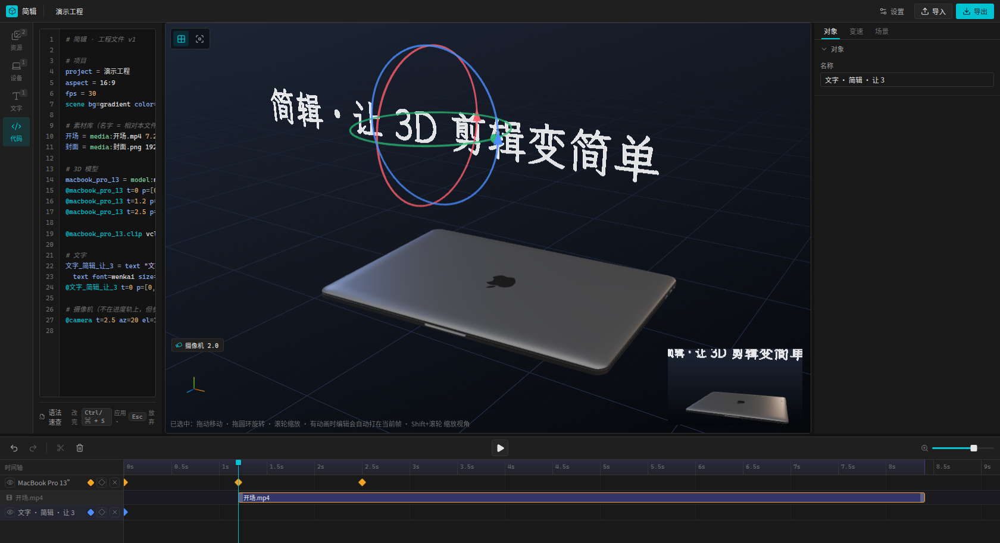

```
# 简辑 · 工程文件 v1

project = 往返测试
aspect  = 4:5
fps     = 30

# 素材库（名字 = 相对本文件的路径；blob 内容不在文件里）
开场 = media:开场.mp4 7.21s 1920x1080
封面 = media:封面.png 1920x1080

# 对象：别名 = 类型:资源 ["显示名"] color=#hex appear=秒
macbook_pro_13 = model:macbook-pro-13-2020 "MacBook Pro 13\"" color=#f5a524
@macbook_pro_13 t=0 p=[0,0,0] s=0 a=[0,-20,0] sc=[1.2,1.2,1.2] f=封面 v=1
@macbook_pro_13 t=1.2 p=[0.192,0,0.096] s=0 a=[0,1.6,0] sc=[1.2,1.2,1.2] f=开场 v=1
@macbook_pro_13 t=2.5 p=[0.4,0,0.2] s=0 a=[0,25,0] sc=[1.2,1.2,1.2] f=封面 v=1
@macbook_pro_13.clip vclip-a1 m=开场 t=1.2 in=0 out=7.21 v=1

文字_简辑 = text "文字 · 简辑 · 让 3" color=#4c8dff
  text font=wenkai size=0.3 color=#ffffff opacity=1 align=center spacing=0 lineheight=1.25 wrap=0 content="简辑 · 让 3D 剪辑变简单"
@文字_简辑 t=0 p=[0,1.45,0.7] s=- a=[0,0,0] f=- v=1

```

**摄像机不写进文件。** 它在这一版里是**固定**的：机位是编辑器的常量，不是作品的数据，
所以工程文件里没有它的位置（手写一行 `@camera` 会被明确指出来：
`第 3 行：摄像机是固定的，工程文件里不需要 @camera`）。工程里已有的摄像机关键帧不会因此丢失 ——
应用文件时那个字段原样保留，只是文件不描述它。

| 行 | 含义 |
| :-- | :-- |
| `project / aspect / fps` | 项目名、画幅、帧率。**没有场景行** —— 场景写在关键帧上，见 `scene=` |
| `别名 = media:路径 [时长] [宽x高]` | 素材库里的资源（**只记文件名**，见下） |
| `别名 = model:资产ID ["显示名"] color=#… appear=秒 [off]` | 一个对象，同时就是"对象名 → 资源"的声明 |
| `别名 = image:素材别名` / `video:素材别名` / `text` | 图片/视频平面、文字对象 |
| `  text font=… size=… content="…"` | 文字对象的排版（缩进两格续行）|
| `@别名 t= p= s= a= sc= f= v= [scene=] [hid] [chain]` | **一个关键帧**：时间、坐标、屏幕开合角度、三轴旋转、缩放、屏幕贴图、变速、**这一帧的场景**、**这一帧是否隐藏** |
| `@别名.clip 片段ID m=素材 t= in= out= v=` | 视频的**附加轨道**（时间裁剪与变速）|

- **`v=` 就是「到上一帧之间」的变速**：写一个数=匀速；写 `[0:1,0.5:0.25,1:1]` 就是曲线上的节点
  （`t:v` 对，逗号分隔）。曲线手柄按节点重新平滑，所以文件里只需要节点本身。
- **`f=` 引用资源别名**，`-` 表示这一帧屏幕上没有东西。
- **`hid` 就是「这一帧没有它」**，和 `scene=` 一样属于帧。前后各一帧、一个写 `hid` 一个不写，
  中间就是一次消失 / 出现。`hid=fade` / `vis=fade` 把这次切换改成**渐隐 / 渐显**：
  淡入淡出铺满整段，并借用这一段的 `v=` **当缓动** —— 于是"变速"就是"淡得快慢"。
  瞬间切和贴图、场景一样是**阶跃**的（不能"消失一半"），所以恰好落在关键帧上的那一帧，
  画面已经切过去了（`p` 在段的末端正好到 1）。
- **`scene=` 把"房间"写在帧上**（`ObjectPose.scene`，与贴图同一个道理：场景也属于帧）。
  对象**首帧**的 `scene=` 就定义好了那一帧的场景，所以文件里不需要一条全局场景行。
  字段用逗号分隔，例如 `scene=bg=solid,color=#101418,env=1,exp=1`。它是**变化标记**：
  只在"与上一帧不同"时才再写一次，所以多数关键帧行没有它 —— 读的时候，**缺省表示沿用上一帧**，
  写 `-` 才是"这一帧不记场景"。这样文件既短，往返又完全无损。
  载入时，文件里**最早的那一帧场景**会同时成为工程的兜底场景（给不记场景的帧和没有关键帧的对象用）。
- **`s=` 只对带铰链的模型有意义**，其它对象写 `-`。
- 坐标写到小数点后 3 位、角度 2 位 —— 足够让"导出再导入"完全回到原样。

**这一页只有两样东西：编辑框和语法速查。**

- **行号 + 代码高亮**：透明的 `<textarea>` 压在一份上了色的同一段文本上，左边是行号列，
  三者一起滚动 —— 这是"不写编辑器也给 textarea 上色"的标准做法。分词器在
  `lib/projectSyntax.ts`：逐词扫描，因为这份格式里有三样东西看着像分隔符其实不是 ——
  十六进制颜色里的 `#`（`color=#f5a524` 不是注释）、引号里的空格（`"MacBook Pro 13\""` 是一个名字）、
  字段列表里的 `=`（`scene bg=solid color=#101418`）。
- **停止输入 1 秒后自动应用**：不是每秒定时写回，而是**防抖** —— 一段连续输入算一次编辑，
  静置时面板绝不碰工程（也就不会往撤回栈里灌东西）。**解析不过就一行都不动**：出错的行在行号列里
  标红，第一条错误贴在编辑框右下角（`第 2 行：需要一个 = 或 @ 开头 · 还有 1 处`），
  半行没写完的代码因此伤不到工程。`Ctrl/⌘ + S` 可以立即应用，`Esc` 放弃改动按当前工程重写，
  `Tab` 插入两个空格 —— 这三个不做提示。
- 应用成功后**缓冲区保持你写的样子**（不立刻用规范格式重写），否则光标会在你还在打字时被弹到末尾。
- 文本没被改动时它是**实时视图**：你在时间线上做的每一步都会立刻反映到文本里。
  一次「应用」算**一步编辑**，`Ctrl+Z` 可撤回。

**素材为什么只记文件名。** 导入的媒体是内存里的 `blob:` URL，写进文件没有意义。所以文件记的是
`media:封面.png` 这样的相对路径；在别的会话里打开工程时，先把同名素材导进来，引用就会自动接上
（缺失的引用会在面板里列成警告，相关帧跳过，其余照常还原）。模型的引用是资产 ID，本来就稳定。

### 导入工程

顶栏的「导入」就是**打开一个工程**（素材的导入在素材区那一侧，两件事分开）：

| 选择 | 做什么 |
| :-- | :-- |
| **点列表里的工程** | **一步到位**：只列**你自己的**工程（仓库自带的示例不进列表），点一下就连同它点名的素材一起导入。 |
| **填路径读取** | 本地工具的直路：填工程文件在仓库里的路径（例如 `promo/macbook-promo.txt`）按 `Enter` 或「读取」——同样会把它点名的素材从磁盘读进来。示例工程走这里，不占列表。 |
| **选择工程文件夹** | 同一条流程的另一入口：工程在仓库之外时用它（`showDirectoryPicker`，不支持时退回 `<input webkitdirectory>`）。 |
| **只选工程文件** | 只读 `.txt` 并应用；素材已经在素材区时用这个。库里缺哪个，面板会列出来，再点一次「补齐缺失的 N 个素材」即可。

**素材始终是自动导入的。** 无论走列表、路径还是文件夹，逻辑只有一条：按代码里写的相对路径去磁盘取
文件、入库、再应用 —— 三者没有功能差别，只是"告诉它工程在哪"的方式不同。

**导入会把机位复位。** 文件不描述摄像机（它永远固定），所以应用一份工程时会把机位恢复成那个
固定的默认取景，并清掉机位关键帧 —— 否则同一份工程在"留下过别的机位"的会话里会拍出不同的画面。
工程因此是**自足**的：同一份文本，在哪台机器、哪个会话里打开，画面都一样。

**为什么列表能直接读盘：这个编辑器是本地工具。** 浏览器打不开"你选的那个 `.txt` 的兄弟文件"，
但本地服务可以 —— `vite.config.ts` 里挂了两条只在本机存在的接口：

| 接口 | 做什么 |
| :-- | :-- |
| `GET /__workspace` | 列出仓库里的工程（`.txt`，跳过 README/license 这类与自带示例 `promo/`）与所有媒体文件（相对仓库的路径）|
| `GET /__workspace/file?path=…` | 读这些文件的字节；支持 Range，所以视频能边读边 seek |

路径一律限制在仓库内（越界直接 403 ✓）。静态部署里没有这两条接口，面板会**安静地不显示列表**，
只留下文件夹/文件两个入口 —— 不会摆出一个按不动的按钮。

**路径是相对代码文件的**，这是这套格式的核心约定：`素材/封面.png` 就是"这个 `.txt` 旁边的
`素材/` 目录里的那个文件"。所以导入时按路径找，**而不是按文件名** —— 两个目录里各有一个
`封面.png` 也不会拿错；反过来，只有**代码点名的**文件会进素材区，同一个文件夹里的成片、静帧、
README、用不上的图都不会被塞进来。`./`、`../` 都会折叠，爬出所选文件夹的路径会退回按文件名兜底。

**为什么第一步是选文件夹而不是选文件**：浏览器里一个 `.txt` 的句柄**够不到它的兄弟文件** ——
只有目录选择（`showDirectoryPicker`，不支持时退回 `<input webkitdirectory>`）才能按路径读盘。
选了文件夹之后，工程文件在树里的位置就是所有引用的基准。

**写回去的路径同样相对代码文件**：从 `promo/素材/封面.png` 导进来的素材，写进 `promo/工程.txt`
还是 `素材/封面.png`，所以"导出 → 换个地方导入"不会越走越偏。

**素材不齐也不会卡住**：工程照常应用，缺文件的那几帧跳过（面板里写明"缺素材 N 个，已跳过相关帧"），
其余全部还原；补齐之后再应用一次即可 —— 二次应用是幂等的。导入一批视频要解码探测，
所以面板会先写"正在导入 N 个素材…"，免得看起来像没反应。

**只读代码里点名的素材**：一个工程文件夹里往往还有成片、静帧、README，那些不会被塞进素材区 ——
`media:` 引用到的名字（含去掉扩展名的同名）才会入库。文件夹里若有多个 `.txt`，取**能解析通过**的那个。

一次导入算**一步编辑**，`Ctrl+Z` 能整体撤回。

> 解析器在 `lib/projectText.ts`：写入与读回成对实现，并且**同精度**往返 ——
> 上面那段文本就是这么生成出来的，实测 0 错误、对象/关键帧/片段/摄像机/场景逐字段一致。

## 素材区：纵向导航 + 三段

左边缘是一条**纵向导航栏**（图标在上、文字在下），一次只显示一段：**资源 / 设备 / 文字**
（曾经还有一个「场景」页，现在场景属于帧，已经并入参数区）。横向排布会挤掉视口宽度，
而素材区的标题都很短，纵向反而更省地方也更好点。

### 三种对象是同一种公民

场景里的东西只有**一种**对象模型：笔记本、文字、图片/视频平面都是 `SceneObject`，都
可选中、可拖动、可打关键帧、在时间线上各占一行。

- **笔记本**：导入的 glTF，带屏幕与铰链。
- **文字**：3D 文字（`kind: 'text'`）。
- **图片 / 视频**：在「资源」里点**添加到场景**，它就以一块平面进入场景
  （`kind: 'media'`）。平面形状取自素材本身的长宽比；它本质上是"一块只有屏幕的显示器"，
  所以屏幕贴图那条管线（cover/contain、亮度、视频片段驱动）原样复用 —— 视频平面因此
  **自动获得自己的视频轨**，可以时间裁剪、剪成多段、各自变速。

三者共用同一套交互实现（`useObjectDrag` 一个 hook），所以"像笔记本一样"不是比喻：
拖动的数学、3 px 阈值、手势期间禁用轨道控制器，都是同一份代码。

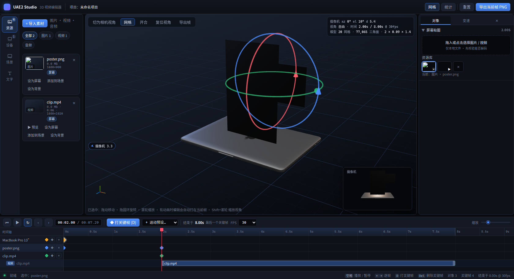

### 资源 —— 你自己导入的媒体

这里**没有任何内置素材**，只有你导入的图片、视频、音频。整段只有一个动作：**「+ 导入」**
（整段也是放置区，文件拖进来就能导入）。筛选条、预览条、各种「设为…」按钮都撤掉了 ——
素材区只负责"把东西拿进来"。

导入的素材排成**网格**：一张缩略图（视频显示首帧）、下面的名字（视频/音频还带时长），
以及右下角一个**绿色加号** —— 点它就把这个素材作为**独立的 3D 平面对象**放进场景，
和笔记本一样可以拖动、旋转、打关键帧（音频没有加号：它没有画面可放）。左上角的 `✕`
从库里删掉这个素材，并**同时清掉所有引用**。

**导入前先校验并测量**：`lib/media.ts` 会真的把文件解一遍（图片等 `onload`，视频等
`loadedmetadata` 并检查 `videoWidth`，音频等 `loadedmetadata`，8 秒超时），确认浏览器
能解码、并顺手拿到宽高和时长。浏览器对 HEVC 这类编码的错误通常要等到真正播放时才暴露，
而一块没有任何提示的黑屏是最糟糕的失败方式。批量导入时失败的条目会被逐条列出，其余照常入库。
这一份逻辑放在 store 的 `importMediaFiles` 里，所以顶栏的「导入」和素材区的「+ 导入」
走的是同一条路径。

### 设备

**库** —— 一个**网格**：每格是设备预览图、图下面是名字（名称超长省略，悬停看全名），
右下角**绿色加号**把设备加进场景，左上角的小圆标显示已经在场景里的份数（点它选中最先加进来的
那台）。上面的搜索框匹配名称、说明与 `keywords`，`macbook`、`笔记本`、`apple` 都能命中。

**场景** —— 场景里每个设备一格，和库一样是**预览图 + 下方对象名**，只是右下角换成
**红色叉号**（从场景里移除，可 `Ctrl+Z` 撤回）。点整格 = 选中该对象（视口出圆环、时间线高亮、
参数区跟着切），选中的那格描一圈蓝边。名称与时间线的行名是同一个字段，在参数区「对象」页改。

> 这一页以前是折叠卡（开合滑块 + 屏幕贴图 + 视频专有项）。改成网格后，**开合**仍可在视口里
> 拖（`L` 开关或 `Shift` 拖动）、**屏幕贴图**仍在参数区「对象」页，但填充/旋转/亮度、
> 循环/静音/速度这几项暂时没有入口了 —— 需要的话说一声，我把它们搬进「对象」页。

**屏幕贴图怎么实现的。** 上传的字节不会进 store：`src` 只是文件选择器给的 `blob:` URL
（内置素材是 data URL）。真正的解码在 `components/viewport/screenTexture.ts` 里完成 ——
把图片或视频**重绘到一块与面板比例一致的 canvas**，再把 canvas 当 `CanvasTexture` 贴上去。
这样做换来三件事，而且图片和视频走的是同一条代码路径：

- `覆盖 / 包含` 是真的裁切或留黑边，不是 UV 缩放导致的边缘拉伸；
- 旋转绕面板中心，任意角度都对；
- 视频用 `requestVideoFrameCallback`（不支持时退回 rAF）逐帧重绘，不会掉帧。

屏幕材质还会被设置成**自发光**（`emissiveMap` + 可调 `emissiveIntensity`），因为显示器是
发光的而不是被照亮的；同时它被排除在「材质预设」之外（`applyMaterialSettings` 的 `exempt` 参数），
切材质预设不会把屏幕一起染黑 —— 但淡入淡出片段的透明度仍然作用于它。

视频贴上屏幕的效果（素材是 ffmpeg 造的测试片段，屏幕上那一帧带着自己的时间码）：

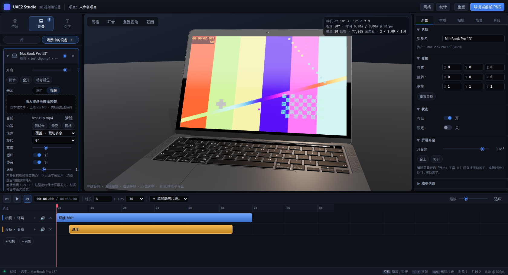

### 旋转 gizmo

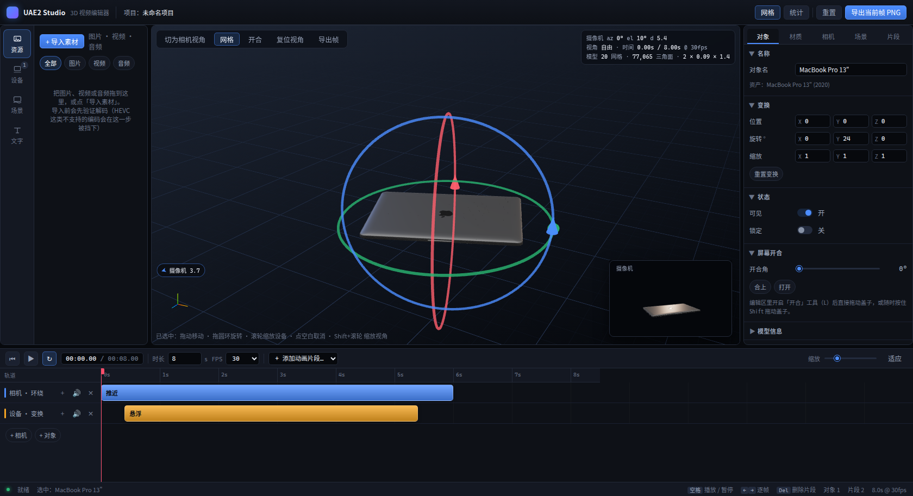

选中任何对象，其包围球外会浮出三个带箭头的圆环，颜色沿用左下角坐标轴（红 X / 绿 Y / 蓝 Z）。

- 圆环是**物体对齐**的，所以拖 X 环写进去的就是 `rotation.x` —— 参数区里看到的数字就是环做的事，
  中间没有欧拉角换算。
- 拖动量取的是**指针在圆环切向上的位移**（投影到屏幕）。这正是"转轮子"的手感：绕着环画弧才有反应，
  往圆环外侧拉不会莫名其妙地转。
  切线方向会做归一化：在切线与视线重合的抓取点上，原始投影长度会塌缩（实测同一段拖拽只转 8°），
  只取方向后全程增益一致（同样 120px 转 31°）。
- 圆环、网格这类**编辑辅助不会进入成片**：渲染小窗和导出帧时，所有 `editor:` 前缀的对象会被临时隐藏。

### 关键帧上下文：对象 / 变速

参数区**永远在看某一帧**，三个标签页各自只管一件事，没有"退出上下文"这回事（那个 `✕`
已经去掉了），点时间线上任意关键帧就切过去。

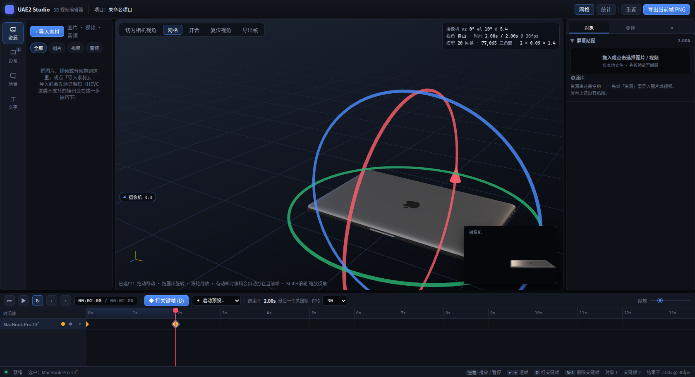

- **对象** —— 两件事：**对象名**（任何对象都能改名，文字卡的标题和时间线的行名会跟着改），
  以及**这一帧的屏幕贴图**。贴图只给 **3D 模型**：只有显示器才谈得上"贴什么"，
  所以文字对象和图片/视频平面在这一页里只有一个名称，没有屏幕贴图那一节。

  **贴图属于帧**：在第 1 秒换上视频，第 0 秒那一帧仍然是原来那张图 —— 换贴图只会写到
  播放头所在的那一帧上，不会把整条时间线一起改掉（这正是这条机制存在的原因）。
  贴图的入口只有两件事：拖入或点选本地文件、清除 —— 没有资源库列表，也没有"先校验能否解码"
  那行小字。
- **变速** —— 只管**这一帧与上一帧之间的播放速度**：一条贝塞尔曲线 + 节点数量。
  拖节点改位置、拖圆点改切线、点空白处插节点，`−`/`+` 在 2–8 之间改节点数。
  **首帧没有上一帧**，所以选中第一个关键帧时这里只写一句「对于首帧，此设置无效」，
  不摆一条你调了也没用的曲线。

### 视频的附加轨道：时间裁剪 / 复制 / 粘贴 / 变速

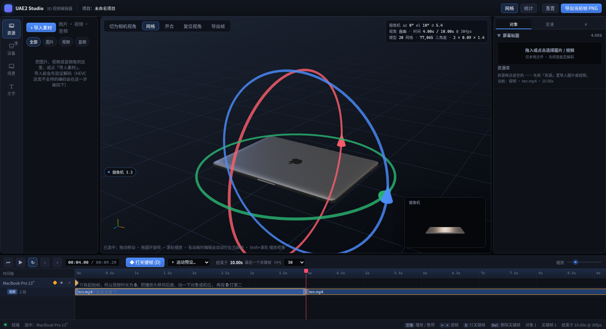

视频和图片不一样 —— 它有**自己的长度**，所以它不挂在某一帧上，而是落在被贴对象的
**第二条轨道**上（对象一行关键帧，下面一行视频）：

- 在某一帧贴上视频，该对象下面立刻出现 **视频轨**，片段起点就是那一帧，长度取**探测到的源视频
  时长**（本地文件走 `probeMediaFile`，把时长带进 `ScreenSettings.duration`；从素材网格加进来的
  平面对象则用素材自己的 `duration`）—— 一段 30 秒的视频就占 30 秒，不会只画一小截；
- **时间裁剪**：拖片段两端改入点/出点。拖头时尾端**钉住不动**，源内位置按屏幕时间同步走，
  画面不会跳；
- **剪成一段一段**：把播放头放到剪口上，点走带上的**剪刀**、右键片段 →「从此处剪开」，
  或直接按 **`X`**（走带上的剪刀只在"选中了片段且播放头落在它中间"时可用）。
  切开用的是**精确的贝塞尔细分**（de Casteljau），两半各自保留自己那一段的曲线形状，
  所以切完总时长、总节奏一点不变 —— 实测一段 10s、带 0.5×→1.5× 斜坡的片段在 4s 处剪开，
  两块宽度 640px + 960px = 1600px，与原片**完全相等**，接缝为 0。切开之后
  **每一段都是独立片段**，可以各自变速、各自再剪、各自复制；
- **删除**：选中片段后点走带上的**垃圾桶**（或按 `Del`）—— 同一个键在有片段选中时删片段、
  没有片段时删关键帧，所以按钮的提示会写明它这一下会删掉什么；
- **复制 / 粘贴**：右键片段 → 复制 / 粘贴到播放头，或 `⌘/Ctrl + C` / `⌘/Ctrl + V`；
- **视频轨会跟着贴图消失**：把某一帧的贴图从视频换成图片、或者点「清除」，只要这个对象
  **再也没有任何一帧是视频**，它的视频轨与片段就一起被清掉（`Ctrl+Z` 可恢复）。反过来，
  贴上一段视频就会立刻为它建出片段；把视频换成另一段视频时轨道保留 —— 判断依据是
  "这个对象还有没有视频要放"，而不是"当前这一帧的贴图类型"。
- **变速**：选中片段，参数区**只剩「变速」一页** —— 片段没有自己的贴图（贴图属于关键帧），
  所以这里给的正是这条片段的贝塞尔速率曲线。曲线均值同时决定片段在时间轴上占多久 ——
  均值 2× 就是半个时长；
- 走带的「结束于」把片段的尾巴算进去，所以贴了视频之后片子会跟着变长。

播放由片段驱动：每帧按片段算出"该在源视频的第几秒、放多快"，画面跟着时间线走而不是自己乱跑。
而且**只有时间线在播放时视频才走** —— 暂停后画面冻结在播放头那一帧（严格 0.02s 容差），
不会出现"编辑区停了、屏幕里那几秒还在循环"的情况。

**片段之间的空白冻结在上一段的最后一帧。** 没有片段在跑时，视频不是"继续放着"，而是
seek 到上一段的出点并暂停（保留帧用 0.02s 的严格容差，播放中才用 0.2s 的宽松容差以避免
解码抖动）；第一段之前没有可保留的帧，就停在第 0 帧。实测把播放头走过头尾相接的两段：

```
3.9s  seek@3.9        （在第 1 段内，播放）
4.2s  seek@4  pause@4 （进入空白：冻结在第 1 段最后一帧）
6.5s  pause@4         （一直冻着，没有继续播放）
8.2s  seek@0.2 play   （第 2 段开始，从源头 0.2s 起播）
```

### 场景也属于关键帧

`场景` 页里的每一项——**背景（纯色 / 渐变）**、环境强度、曝光——改动都会写进**播放头所在那一帧**，
`ObjectPose.scene` 是姿态的一部分。渲染时 `resolveSceneState(objects, time)` 在前后两帧之间
**插值**（并且跟着这一段的变速曲线走），所以换个背景色是**平滑过渡**，不是硬切：

- 颜色按 RGB 插值、角度/浓度/模糊/环境强度/曝光按数值插值；
- **离散的选项**（纯色还是渐变、哪张素材）落在关键帧上 —— 它们没有"一半"可言；
- 实测 0s 红 → 3s 蓝：`rgb(255,0,0) → rgb(191,0,64) → rgb(128,0,127) → rgb(64,0,191) → rgb(0,0,255)`，
  环境强度同步 `0.2 → 1.1 → 2.0`。

因为插值每帧都在变，光照与背景**不走 React 渲染**：`SceneTuning` 在 `useFrame` 里直接写
`scene.environmentIntensity` / `renderer.toneMappingExposure`，背景色则通过 store 订阅
（播放时即每帧触发）直接写到那层 DOM 的 `style.background` 上 —— 静止时零开销，播放时逐帧平滑。
接触阴影因为要重算阴影贴图，仍是**阶跃**。

背景分**纯色**与**渐变**两档：纯色只有一个颜色；渐变是起点、终点两个颜色加一个角度
（`linear-gradient(<角度>deg, 起点, 终点)`）。在纯色档取色会顺手把类型切成纯色，
所以取色永远是一个看得见结果的调节。
接触阴影仍在数据里、也仍参与渲染，只是参数区不再提供入口（它的界面已按需求撤掉）；
图片 / 视频背景同理 —— `scene.background` 里那几个字段还在，`BackdropLayer` 也还认，
只是目前没有 UI 能把 `type` 切成 `media`（资源区只留了导入与"加进场景"）。

同一个瞬间的所有关键帧会一起写上同一份场景（房间是共用的），所以读谁都不会有歧义；
一个关键帧都没有的对象则继续用全局场景兜底。

实测：0s 帧设 `#123456`、2s 帧设 `#aa0000` → 关键帧里存下 `[[0,#123456],[2,#aa0000]]`，
拖播放头时画布背景在 0.5s / 1.9s 是 `rgb(18,52,86)`、2.5s 是 `rgb(170,0,0)`。

### 变速 = 关键帧之间的内容变速

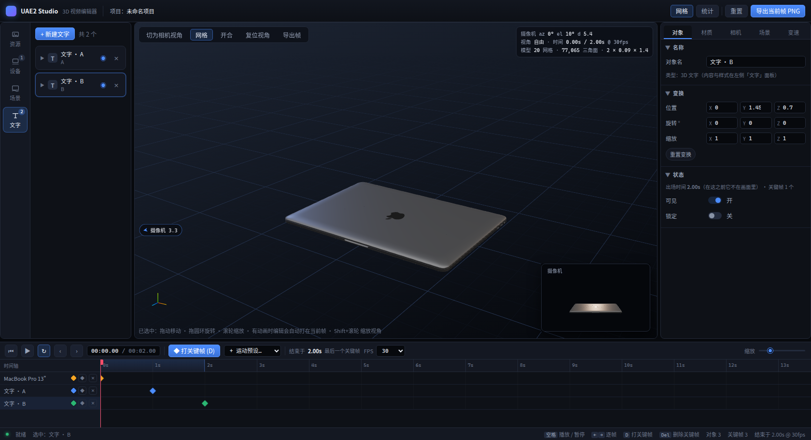

参数区最后一个页签是**变速**。按你的剪辑理念，一条曲线不是一个"效果"，而是
**上一个关键帧 → 这一个关键帧**之间那段内容的节奏：

- x 轴是这段内容的播放位置（0–100%），y 轴是速度倍率；
- 曲线先算积分再归一化，得到内容进度 `p`。`p` 单调，所以这一段**必定**走到下一个关键帧；
- 常量倍率不会改变节奏（归一化会把它约掉），只有**形状**才改变 —— 这是设计使然，不是 bug。

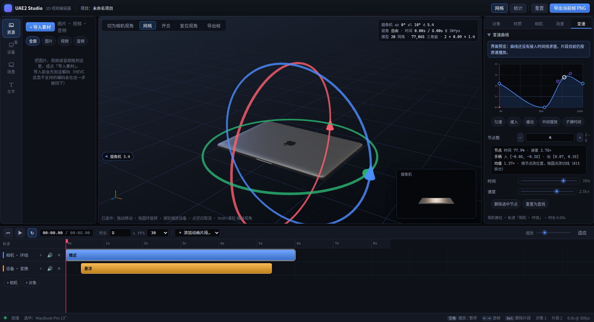

- **节点数可自定义**：`−` / `+` 在 2–8 之间调整，改数量时按**当前曲线的形状重采样**。
  图表下面只有这一个控件 —— 曾经还有一块"节点 / 手柄 / 均值"的文字读数，它只是把手上正在做的事
  又用文字重复了一遍，已经去掉。
- **直接拖**：拖节点改位置与速度，拖圆点改切线；切线默认镜像，`Alt` 拆分；
  点图表空白处就地插入节点。
- **自动平滑**：节点一动就用邻居重推切线；手柄被限制在本段内 —— `evaluateSpeed` 用二分法解
  `x(s) = t`，需要 x 单调。
- **改曲线会重排时间轴**：每个关键帧记着一个**内容时长** `sourceSpan`（未被变速的原始长度），
  这一帧在时间轴上的真实跨度 = `sourceSpan ÷ 曲线均值`。所以把均值调到 2×，
  这一段就用一半的时间走完，**这个关键帧和它之后所有关键帧一起左移**，片子总长跟着变。
  面板上直接写出这笔账：`内容时长 2.00s ÷ 曲线均值 1.00× = 变速后 2.00s`。
  反复调不会累积误差：`sourceSpan` 从不被变速改写（`span × 均值 = 原值` 恒等）。
  手动拖关键帧则是反向操作 —— 拖出来的跨度反过来定义 `sourceSpan`。

摄像机的段变速用同一个编辑器，只是入口在**相机**栏里 —— 参数区不会为同一件事给两个入口。

实测（设备在 0s→2.7s 之间从 x=0 移到 x=1，取 1.35s 处的内容进度）：

| 曲线 | 内容位置 | 含义 |
| :-- | :-- | :-- |
| 匀速 | 0.500 | 线性 |
| 缓入（先慢后快） | 0.341 | 内容**滞后** —— 前半段在原地多待了一会 |
| 缓出（先快后慢） | 0.659 | 内容**超前** |
| 常量 0.5× | 0.500 | 节奏不变（归一化约掉了倍率） |

### 两台相机：编辑视角 vs 摄像机

这是整个编辑区最重要的一个区分：

| | 编辑视角 | 摄像机 |
| :-- | :-- | :-- |
| 谁在用 | 你（创作者） | 成片 |
| 怎么动 | 鼠标拖动旋转 / 滚轮推拉 / 右键平移 | 参数区「相机」的机位与取景，以及时间线上的相机片段 |
| 在哪看 | 主视口 | **右下角小窗**（贯穿整个编辑过程实时显示） |
| 受运镜影响 | 不会 | 会 |

摄像机是独立的一台：它的机位、焦距、以及时间线上的运镜，**永远不会把编辑视角带走** ——
所以在镜头动画中间微调对象时，屏幕上的 X/Y/Z 方向是稳定的。

摄像机在编辑区里有一个**标记**：一台常量屏幕尺寸的小摄影机模型（`viewport/CameraMarker.tsx`），
站在摄像机的位置、镜头指着注视点。它每帧按深度反向缩放，所以 20 米外的摄像机和 2 米外的看起来
一样大 —— **标记抵消透视，而不是遵循透视**；它同时是无光照、无深度测试、并被排除在成片之外的，
本质是一块恰好住在 3D 里的 UI。

标记会跟着**运镜**走：播放时间线时能看着它在场景里飞，右下角小窗同步播放它看到的东西。

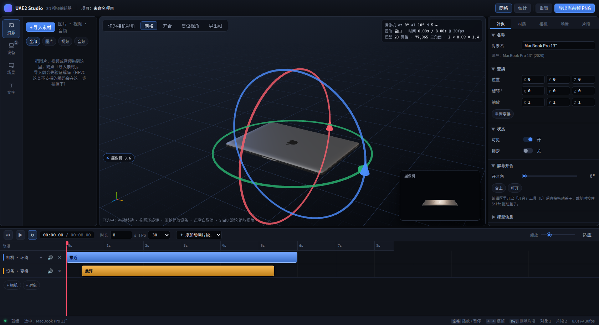

**小窗和导出都带背景。** 编辑视口的画布是透明的（背景是画布**背后**的一层 DOM ——
视频背景要一直播），所以拍摄通道必须自己把背景画进去：拍摄时给 `scene.background` 临时挂一个
纯色或渐变贴图，画完立刻还原。实测小窗角落像素 = 背景色 `#ff2d55` → `[255,45,85]`，
渐变 `180deg 白→蓝` 在小窗里同样是上白下蓝（纯色是精确值，没有被色调映射改过）。

小窗左边的胶囊是**离屏指示器**（上图的左边缘）：摄像机跑到画面外时（默认视角下它常常就在你
侧后方），胶囊钉在最近的屏幕边缘、用箭头指出方向、显示距离，点一下直接切进摄像机视角。
没有它，这个功能有一半时间是隐形的。

想钻进摄像机看构图，点视口工具条的「**切为相机视角**」；再点一下回到你自己的视角
（回到自由视角时会精确恢复你原来的机位，因为 `store.view` 一直记着它）。

小窗是用**同一次渲染的 scissor 分屏**画出来的：同一份场景、同一份贴图，被画三次到不同的
矩形里（主视口 / 小窗 / 左下角坐标轴），所以不需要第二个渲染器、不用复制场景，屏幕上的
视频也只有一路解码。「导出帧」会请渲染循环画一帧**干净的小窗画面**（无叠加、透明背景），
再回传给按钮下载 —— 见 `lib/capture.ts` 与 `viewport/ShotPreview.tsx`。

### 文字

3D 文字对象，和设备共用同一套变换、选中与时间线规则。

**卡片标题就是文字内容**（不再显示对象名 + 一行小字预览）：一眼就能认出是哪一段词。
内容仍然在卡片里的「内容」输入框里编辑，对象名则在参数区「对象」页改。

展开后可以改：内容、字体、字号、颜色、不透明度、字距、行高、对齐、换行宽度，以及
「复位位置」。**位置、面向相机、正视机位都已去掉**：位置在视口里拖、用圆环转就是了，
不必再摆一组 XYZ 输入框；文字按自己的朝向摆放，不再提供一个"永远正对镜头"的开关
（`TextObject` 里那条分支还在，只是没人再改它）。

字体全部来自 `public/fonts/`（霞鹜文楷 18 MB 带中文、DejaVu Sans 0.7 MB 只有拉丁字母）。
**刻意不用 CDN 字体**：troika（drei 的文字渲染器）会给一个字体 URL 去解析，离线或被墙的机器上
拿到的是空白字形而且不报错，这种失败无声无息。选到不含中文字形的字体时会直接在面板里提示。

## 顶栏：项目的三个动词

左边是 logo（占位）和名字 **简辑**，紧跟着**项目名** —— 点一下就地变成输入框，
`Enter` 或点到别处提交，`Esc` 放弃（空名会退回「未命名项目」）。右边只有三件事：

| 按钮 | 做什么 |
| :-- | :-- |
| **导入** | **导入工程**：读出工程文本，并把它提到的素材自动拉进素材区。详细见下 |
| **设置** | 只有一个选项：**画幅**（16:9 / 9:16 / 1:1 / 4:5 / 21:9）|
| **导出** | 弹出导出面板：**整片 MP4**（逐帧求值后编码）或**当前帧 PNG**（按摄像机取景、按画幅居中裁切、带背景）|

**画幅**决定三件事，而它们是同一个数：右下角**拍摄小窗**的形状、**播放弹窗**里画面的比例、
**导出图**的尺寸。编辑窗口是什么形状都无所谓，成片永远是你选的画幅。

三者共用 `lib/` 里同一个 `letterbox()`：在画布中央取一块尽可能大的、符合画幅的矩形，
渲染通道用 scissor 只画那块，小窗和弹窗都按同一个矩形取景，导出也按它裁切。
所以 1:1、4:5、9:16 这些竖画幅下**不会出现拉伸**，21:9 这种横画幅也不会被悄悄裁掉两边 ——
竖画幅时小窗从底边向上长高（4:5 约 282px、9:16 约 402px），横画幅时它是一条扁带（21:9 约 96px）。

顺带记一句踩过的坑：弹窗最初是把整幅画布按横向压进画布的，16:9 看着没问题，
一换到 1:1 / 4:5 就明显歪 —— 因为那种写法只对"以宽为限"的横画幅成立。

### 导出 MP4

**不是录屏，是逐帧求值。** 每一帧都走一遍和编辑时完全相同的求值路径：

```
for i in 0 … total-1:
  t = i / fps
  seek(t)                  # 把播放头放到这一帧
  等两帧渲染               # 让 useFrame 把新的时间推进画面
  等所有屏幕视频 seeked     # 视频贴图必须落在"属于这一帧"的源画面上
  再等一帧渲染             # 纹理重画完
  抓一张干净的成片帧        # 复用渲染通道的拍摄路径（无叠加、按画幅裁切、带背景）
  VideoEncoder 编码这一帧
```

- **为什么不用 `MediaRecorder` 录画布**：它是实时的，机器一卡就丢帧，而且会把"当时视频元素
  碰巧在放哪一帧"录进去。逐帧求值的结果与机器快慢无关，同一份工程导两次是一样的。
- **视频贴图的确定性**：`screenTexture.ts` 里有一个**导出模式** —— 一旦打开，屏幕视频停止
  "播放"、改为"严格 seek"（容差 0），并把每个 seek 的 `seeked` 事件登记到 `pendingSeeks`，
  导出循环用 `videosSettled()` 等它们全部落地。这就是"视频画面的那几拍也能进导出图"的原因。
- **编码与封装**：WebCodecs 的 `VideoEncoder`（H.264，从高到低试 `avc1.640028` /
  `avc1.4d0028` / `avc1.42001f`），`mp4-muxer` 封装成 MP4，`fastStart: 'in-memory'` 让
  moov 放在文件头（方便边下边播）。码率按 `宽 × 高 × fps × 0.09` 估。
- **尺寸**：输出的高度上限 1080，宽高都取偶数（H.264 的要求），比例来自项目画幅。
- **队列**：`encodeQueueSize > 8` 就等一下 —— 否则长片会把内存吃光。
- **取消**：`AbortController`；无论成功失败，最后都把播放头放回你原来待着的那一帧。

## 播放弹窗：看一遍成片

时间轴上方居中的 **▶** 打开播放弹窗：画面居中、下方一条播放条（播放/暂停、进度条、
当前时间 / 总时长、全屏、退出）。打开即从 0 秒开始播，退出即暂停。

弹窗里的画面**不是录下来的文件**，而是让渲染通道把摄像机画面按画幅铺满整个画布，
弹窗再把这个画布**逐帧拷进自己的 2D 画布**（`drawImage`）。这样只有一个渲染器、一份场景、
一份屏幕贴图 —— 不需要第二次初始化 WebGL，也不需要录制。`Esc` 退出，`空格` 播放/暂停；
全屏按钮调的是 `requestFullscreen`，进全屏的是画面本身而不是整个页面。

## 撤回 / 重做

`Ctrl/⌘ + Z` 撤回、`Ctrl/⌘ + Y`（或 `Ctrl+Shift+Z`）重做，时间轴左上角那两个箭头按钮同理
（没有可撤的步骤时按钮置灰）。

实现上是**快照式**的：每个动作都经过 store 包的一层 `set`，改完比对
"对象 / 场景 / 素材 / 项目 / 摄像机关键帧 / fps"有没有变 —— 变了就把改动**之前**的那份快照
压进 `past`。所以选中、拖播放头、切页签、转编辑视角这些"导航"动作**不会**塞满撤回栈
（撤一步却什么都没变，是最让人恼火的手感）。

拖动这类连续手势只留**一步**：`lib/gesture.ts` 在指针按下/松开时广播边界，store 在按下时
记住快照、松开时若真的变了才压栈 —— 拖一个对象 3 秒不会产生 60 个撤回步骤。

## 交互

| 操作 | 快捷键 / 手势 |
| :-- | :-- |
| **播放效果视频** | 点时间轴上方居中的 **▶** 打开播放弹窗（见下一节） |
| **撤回 / 重做** | `Ctrl/⌘ + Z` / `Ctrl/⌘ + Y`（`Ctrl+Shift+Z` 也可以重做） |
| 播放 / 暂停 | `空格` |
| 逐帧 / 半秒 | `←` `→` / `Shift` + `←` `→` |
| 回到起点 / 跳到结尾 | `Home` / `End`（结尾=最后一个关键帧） |
| **打关键帧** | `D`：给选中对象在当前时间打帧（抓屏幕上显示的插值姿态）；没选中对象时打给摄像机 |
| **从此处重绘** | 关键帧上右键 → 该对象这一帧及其后变白，并把这一帧的状态写进后面所有已存在的关键帧 |

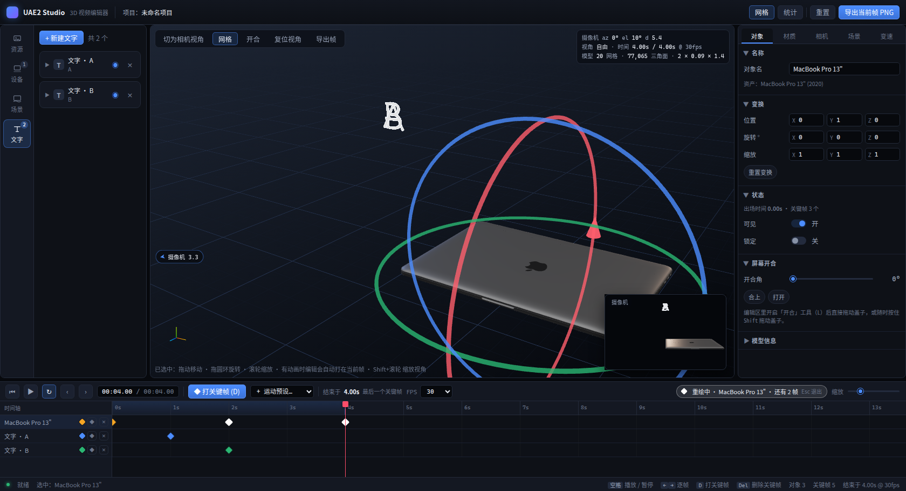
| **切到上/下一帧** | 重绘链里切到下一帧时会自动带上刚改完那一帧的状态 |
| **退出重绘** | `Esc` |
| 跳到某一帧 | 点时间线上的关键帧菱形 |
| 编辑自动入帧 | 有动画的对象：拖动/改参数会写成**当前帧**（同一时刻只留一帧，不会刷屏）|
| 删除关键帧 | `Del` |
| 网格开关 | `G`（视口左上角也有按钮，旁边是「复位视角」）|
| 开合工具开关 | `L` |
| 屏幕开合 | 开着「开合」工具拖动盖子；或任意时刻 `Shift` + 拖盖子 |
| **未选中任何对象** | 拖动旋转 · 滚轮缩放视角 · 右键平移 |
| **选中设备** | 拖动 = 移动该设备 · 滚轮 = 缩放该设备 · `Shift`+滚轮 = 缩放视角 |
| **旋转设备** | 选中后出现三个圆环（红 X / 绿 Y / 蓝 Z），顺着圆环切向拖动即可绕该轴旋转 |
| 取消选中 | 点空白处（或 `Esc` 前先点空白） |
| 切为相机视角 | 点场景里的摄像机图标，或点视口边缘的「◀ 摄像机」胶囊 |
| 回到自由视角 | 摄像机视角下点左上角的「↩ 退出摄像机视角」 |
| 摄像机视角里拖动 | 空白处=退出摄像机视角并继续旋转视角 · 滚轮=推拉 · 拖对象/圆环=照旧操作对象（不退出）|
| 导出 | 顶栏「导出」：**整片 MP4**（逐帧求值 + H.264）或当前帧 PNG（按摄像机取景、按画幅裁切、带背景）|
| **剪切片段** | `X`（或走带上的剪刀 / 右键片段 →「从此处剪开」）：在播放头把选中的视频切成两段 |
| **删除选中** | `Del`（或走带上的垃圾桶）：删掉选中的**视频片段**；没有片段时删掉选中的**关键帧** |
| 时间线 | 点标尺定位 · 拖关键帧菱形移动（0.05s 吸附）· **右键关键帧**：从此处重绘 / 跳到这一帧<br>菱形**琥珀色**=普通关键帧，**白色**=在重绘链上 |
| 时间轴缩放 | 走带右侧的滑块：**8 – 600 px/s**。滑块是**对数**刻度，所以两端都好调（线性刻度会把 100 px/s 以上全挤进最后几个像素）；标尺刻度跟着自动选档（8 px/s 时每 10s 一格，600 px/s 时每 0.25s 一格）|
| 对象行左侧的图标 | **眼睛**：显示 / 隐藏这个对象（隐藏后不进成片）|

## 示例工程：一支 MacBook 宣发片

[`promo/`](promo/) 里有一支 22.6 秒的苹果风格 MacBook 宣发片 —— **它整个就是一份工程文本**
（`promo/macbook-promo.txt`）。把 `promo/` 里的素材导进素材区，再把那份文本粘进「代码」页，
一秒后你就得到这支片子。

它把这里的机制都用了一遍：开合角度演"掀盖"、文字对象演"标题滑入"、贴图切换演"屏幕换画面"、
视频轨的 `.clip` 演"裁剪 + 变速"、逐帧场景演"灯亮灯暗"（还用相邻关键帧做了两次曝光脉冲）。
摄像机全程不动 —— 所有运动都来自对象本身与逐帧场景。详细分镜见 [`promo/README.md`](promo/README.md)。

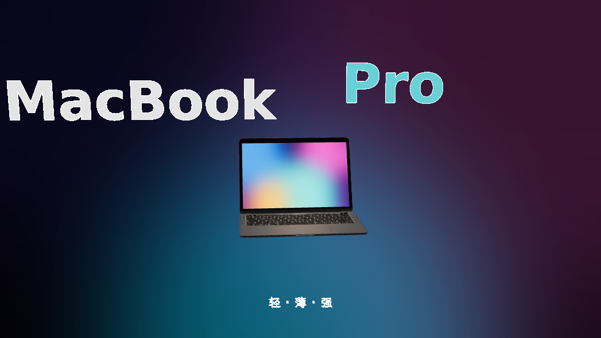

## 换成你自己的模型

1. 把 glTF 文件夹丢进 `public/models/<名字>/`（贴图相对路径保持不变）。
2. 在 `src/lib/assets.ts` 的 `MODEL_ASSETS` 里加一条记录。
3. 刷新即可 —— 自动归一化、自动测量、自动出现在设备库里。
4. 想让它能开盖就再加一个 `hinge` 字段，想让它的屏幕能换贴图就再加一个 `screen` 字段：

```ts
export const MODEL_ASSETS: ModelAsset[] = [
  {
    id: 'my-laptop',
    name: 'My Laptop',
    url: '/models/my_laptop/scene.gltf',
    note: 'glTF 2.0 · 含贴图',
    size: '3.2 MB',
    // 节点的原点即铰链轴心；本地 +X 是轴向，本地 +Z 是合盖时盖子的朝向。
    // 省略这个字段就是一个不可开合的普通模型。
    hinge: { node: 'Lid', maxDeg: 135, fullDeg: 120 },
    // 屏幕用**材质名**绑定，不用网格名：一块屏幕通常就是一个材质加一块平面网格，
    // 而材质名在归一化之后依然可靠。aspect 是面板宽高比，决定素材怎么裁切/留黑边。
    screen: { label: '内屏', material: 'Screen_Mat', aspect: 1.6 },
    keywords: ['laptop', '笔记本'],
  },
]
```

节点名与材质名怎么找：用任何 glTF 查看器（或 `gltf.report`）看节点树，节点找那个**枢轴位于机身
转轴处**的；材质名直接在 `scene.gltf` 的 `materials[].name` 里读。别只按名字猜 —— 本项目内置
模型的「屏幕」看起来像 `Macbook Pro_4`，但那其实是一个退化的线状网格；带屏幕总成的是
`Bevels_2`，真正画屏幕的材质是 `Material.002`。

## 已知情况

- **内置模型可以开盖。** 屏幕总成在 glTF 里是独立节点 `Bevels_2`，其原点正好落在机身后缘的
  厚度中线上，也就是铰链；文件里还自带一条 0.04s → 16.7s 的开合动画（最大 119.9°）。
  编辑器**不播放**这条动画（时间线求值必须是纯函数，而 `AnimationMixer` 是有状态的），
  而是直接驱动该节点的 `rotation.x`，所以角度可以任意拖、来回拖、拖到极限。
- **关键帧抓的东西**：位置/旋转/缩放 + 开合角度 + 这一帧的屏幕贴图 + 这一帧的场景
  （背景/照明/曝光/阴影）。还没进关键帧的只剩**文字内容**和材质。
- **机位角度没有 UI 入口**：相机页、左侧场景页、运动预设，以及"拖动调机位"都已按需求撤掉，
  现在只剩滚轮推拉距离。构图靠**移动对象**（这也是本项目的思路：摄像机是固定的那只眼睛）。
  若还想要手动机位，最省事的约定是按住 `Alt` 拖动 = 调整机位，`CameraRig` 里那条
  `updateCamera({ azimuth, elevation })` 路径已经是现成的。
- **接触阴影是阶跃的**：背景色与光照会在两帧之间插值，但接触阴影的柔化要重算阴影贴图，
  所以它仍在关键帧处直接切换。
- **文字的淡入淡出走的是另一条通道**：troika 的文字材质**不读 `material.opacity`**（它的字形
  认 `fillOpacity`，而且组件每帧把它自己的 prop 推进 uniform），所以文字对象的 `applyFade`
  会被跳过、改用 `fillOpacity` 这个 prop —— 别的对象（模型、图片/视频平面）依旧是直接写材质，
  它们的 `opacity`/`transparent` 是现成的。另外这些基准值只在"完全没在淡"的时候采样，
  否则一次淡出中途开始的新淡出会把基准值本身当成半透明。
- **单步撤回只覆盖"编辑"**：选中、拖播放头、切页签、转编辑视角不进历史（见「撤回 / 重做」）。
- **导出 MP4 是逐帧求值的，不是录屏**：见下面「导出 MP4」一节。代价是慢（一帧要等一次
  屏幕视频 seek），而且导出期间窗口必须在前台 —— 浏览器在后台会节流 `requestAnimationFrame`。
- **导出没有音频**：时间线上还没有音频轨，所以 MP4 只有画面。
- **导出画面不透明**：只出 H.264 的 MP4。要透明背景得再加一路 WebM/VP9 alpha 或 ProRes。
- **音频只到"素材库"为止**：导入的音频会进资源库、能显示时长，但音频轨、波形、音量包络和
  导出混音都还没做（连"设为配乐"的入口也随资源区的精简一起撤掉了，`scene.soundtrackId`
  这个字段还留着）。
- **媒体库不持久化**：素材用的是 `blob:` URL，刷新页面即失效（项目序列化还没做，见路线）。
- `public/fonts/` 里的霞鹜文楷是 18 MB，构建产物会带上它。不需要中文文字的话，删掉该文件并在
  `lib/fonts.ts` 里移除对应条目即可。

## 素材署名

内置模型 "Macbook Pro 13 inch 2020" 来自
[Sketchfab](https://sketchfab.com/3d-models/macbook-pro-13-inch-2020-efab224280fd4c3993c808107f7c0b38)，
作者 **timblewee**，以 **CC-BY-4.0** 授权（允许商用，**要求署名**）。
完整声明见 `public/models/macbook-pro-13-2020/license.txt` —— 发布或分发本项目时请一并保留。

## 后续路线

1. **音频轨**：把资源库里的音频放上时间线（波形、音量包络、多条音轨），然后一并混进导出的 MP4。
2. **关键帧曲线**：把片段的线性参数升级为可编辑曲线 + 曲线编辑器。
3. **透明背景的导出**：现在只出 H.264 的 MP4（不透明）。要透明得走 WebM/VP9 alpha 或
   ProRes 4444，编码器与容器都得再加一路。
4. **更快的导出**：一帧一次 `requestAnimationFrame` 等待是稳，但慢；可以把渲染与编码拆到
   两个 worker 里流水起来（`OffscreenCanvas` + `VideoEncoder`）。
5. **项目序列化**：`.uae2` 文件存盘 / 读盘 / 分享（`blob:` 素材要转存成文件包里的副本）。
6. **更多设备与场景**：手机、平板、手表 + 预设运镜模板 + 可选的台面/背景板。

## 开发辅助

`scripts/shot.mjs` 通过 CDP 在模型加载完成后截图，用于自动化视觉检查（需要先启动
带 `--remote-debugging-port=9222` 的 Chrome）：

```bash
node scripts/shot.mjs http://127.0.0.1:5273/ /tmp/shot.png 2 "__UAE2__.getState().seek(3)"
```

开发模式下 store 挂在 `window.__UAE2__`（视口挂在 `__UAE2_VIEW__`），可以在浏览器
控制台直接驱动编辑器：

```js
__UAE2__.getState().applyCameraPreset('top')
__UAE2__.getState().seek(3)
__UAE2__.getState().setObjectLidOpen('device-main', 118)
__UAE2__.getState().setObjectScreen('device-main', { source: 'video', src: '/clip.mp4', fileName: 'clip.mp4' })
__UAE2__.getState().addTextObject('UAE2 Studio')
__UAE2__.getState().addClip({ trackId: 'track-camera', kind: 'orbit', name: '环绕', duration: 4, easing: 'easeInOut', params: { turns: 1 }, color: '#4c8dff' })
```
